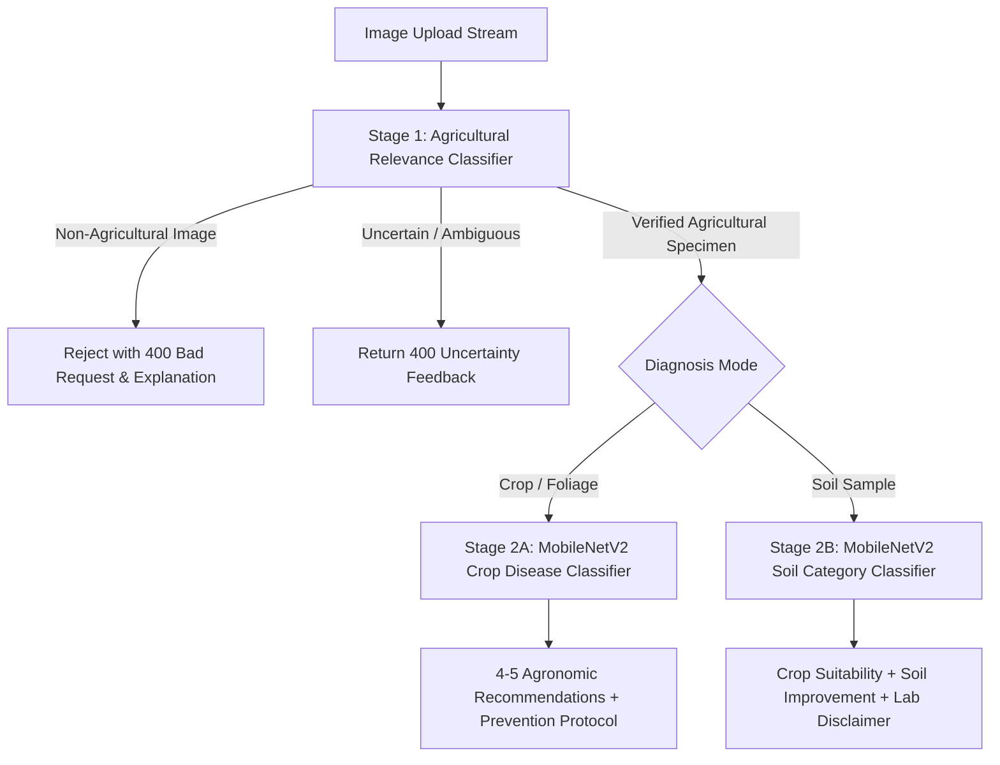

# AGRO AI — Architecture Documentation

**Tagline:** Smart Agriculture. Healthy Lives. Better Future.

---

## 1. High-Level Architecture Overview

AGRO AI is built on a modern decoupled client-server architecture designed for high availability, zero external AI API costs, and robust local execution.

```
+-------------------------------------------------------------------------+
|                         AGRO AI Client (Vite + React)                  |
|  - Typescript + Tailwind CSS UI                                        |
|  - Better Production (Crop & Soil Vision UI)                           |
|  - Better Nutrition (BMR/TDEE & 7-Day Meal Scheduler)                 |
|  - AGRO AI Assistant (Conversational Knowledge Interface)              |
+------------------------------------+------------------------------------+
                                     |  REST API / Multipart Form / JSON
                                     v
+-------------------------------------------------------------------------+
|                        FastAPI Server (Python 3.10+)                    |
|  - JWT Authentication & Role-Based Access (Farmer, Buyer, General)     |
|  - Route Dispatchers & Input Validation via Pydantic v2                |
|  - Agricultural Relevance Validation Gateway                           |
+---------+-------------------+--------------------+---------------------+
          |                   |                    |
          v                   v                    v
+------------------+ +------------------+ +-------------------------------+
|  SQLite Database | |   ML Inference   | |    Nutrition & Knowledge      |
|  - SQLAlchemy    | |  - MobileNetV2   | |  - Mifflin-St Jeor Engine     |
|  - Users         | |  - Crop Diseases | |  - Structured Food Nutrition  |
|  - Diagnostics   | |  - Soil Category | |  - 7-Day Schedule Generator   |
|  - Diet Plans    | |  - Fallback Vision| |  - Local Agricultural KB     |
+------------------+ +------------------+ +-------------------------------+
```

---

## 2. Core Pillars & Subsystem Design

### Pillar 1: Better Production (Vision Intelligence)
The visual diagnostic pipeline enforces a two-stage gatekeeper pattern:



### Pillar 2: Better Nutrition (Scientific Diet Planning)
- **Metabolic Baseline:** Mifflin-St Jeor equation calculates Basal Metabolic Rate (BMR).
- **Expenditure Multiplier:** Activity multipliers (Sedentary 1.2 to Very Active 1.9) yield Total Daily Energy Expenditure (TDEE).
- **Target Adjustment:** Automated calorie adjustments based on health goal (weight loss -450 kcal, maintenance, weight gain +350 kcal).
- **7-Day Scheduler:** Assembles 5 daily meals (Breakfast, Mid-morning, Lunch, Evening Snack, Dinner) from a verified nutritional database while strictly filtering out allergens.

### Pillar 3: AGRO AI Assistant (Zero Paid API Knowledge System)
- Rule-based intent classification covering crop diseases, plant pathology, soil fertility, fertilizers, and diet calculations.
- Contextual suggestion generation and direct deep-linking to corresponding platform tools.

---

## 3. Database Schema Design (SQLite & SQLAlchemy)

### Users Table (`users`)
- `id` (VARCHAR(36), PK): UUID
- `full_name` (VARCHAR(100)): User's name
- `email` (VARCHAR(150), UNIQUE, INDEX): Login email
- `hashed_password` (VARCHAR(255)): Bcrypt password hash
- `role` (ENUM): `farmer`, `buyer`, `general`, `admin`
- `created_at`, `updated_at` (DATETIME)

### Production Analyses Table (`production_analyses`)
- `id` (VARCHAR(36), PK): UUID
- `user_id` (VARCHAR(36), FK): Optional associated user
- `analysis_type` (VARCHAR(20)): `crop` or `soil`
- `image_filename` (VARCHAR(255)): Stored image reference
- `is_agricultural` (BOOLEAN): Relevance check flag
- `predicted_class` (VARCHAR(100)): Crop or soil category
- `sub_category` (VARCHAR(100)): Pathogen or sub-type
- `confidence` (FLOAT): Model confidence score
- `recommendations_json` (TEXT): Serialized recommendations
- `created_at` (DATETIME)

### Saved Diet Plans Table (`saved_diet_plans`)
- `id` (VARCHAR(36), PK): UUID
- `user_id` (VARCHAR(36), FK): User identifier
- `profile_summary_json` (TEXT): BMR, TDEE, macros, allergens
- `plan_data_json` (TEXT): 7-day 5-meal schedule
- `created_at` (DATETIME)

---

## 4. Security & Safety Principles

1. **Password Security:** Cryptographic password hashing using direct `bcrypt` with adaptive salt rounds.
2. **Path Traversal Protection:** Sanity checks on all image uploads and local file paths.
3. **No Paid API Dependency:** All AI capabilities function independently of cloud billing, keys, or external token quotas.
4. **Honest ML Diagnostics:** Visual soil assessment provides physical and structural guidance while explicitly disclaiming fabricated chemical N-P-K numbers and recommending accredited laboratory testing.
