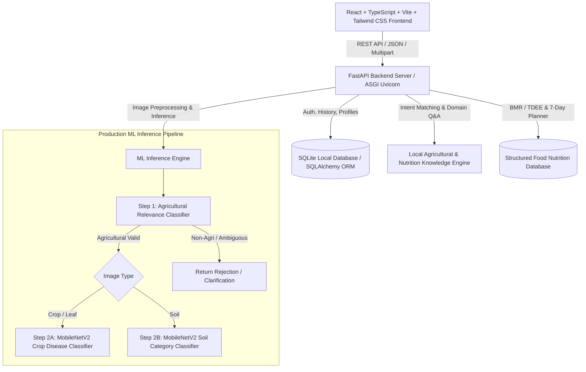

# AGRO AI — Implementation Plan

**Tagline:** Smart Agriculture. Healthy Lives. Better Future.

---

## 1. Executive Summary & Core Objectives

AGRO AI is a full-stack smart agricultural and nutrition platform engineered with three dedicated pillars:
1. **Better Production**: AI-driven crop disease diagnosis and visual soil classification with built-in agricultural image relevance filtering.
2. **Better Nutrition**: Scientific BMR/TDEE calorie & macro calculation with an automated 7-day personalized meal planner based on a structured nutritional food database.
3. **AGRO AI Assistant**: A zero-external-API, rule-based & knowledge-retrieval conversational agent for agricultural guidance, disease management, and nutrition counseling.

---

## 2. System Architecture

---

## 3. Technology Stack

| Layer | Technology | Key Libraries / Modules |
|---|---|---|
| **Frontend** | React 18 / 19, TypeScript, Vite | Tailwind CSS, Lucide React, Axios, React Router Dom |
| **Backend** | Python 3.10+ / FastAPI | Uvicorn, Pydantic v2, SQLAlchemy, Python-JOSE / Passlib / Bcrypt, Pillow, NumPy |
| **Machine Learning** | TensorFlow / Keras (or PyTorch/ONNX lightweight runtime), Scikit-Learn | MobileNetV2, ImageDataGenerator / Keras Preprocessing, Pandas |
| **Database** | SQLite3 | SQLAlchemy Async/Sync ORM, Alembic-compatible schema |
| **Testing** | Pytest, HTTPX, Jest / Vite test | Automated unit & integration tests for all endpoints |

---

## 4. Phased Implementation Roadmap

### Phase 1: Environment & Project Foundation
- Initialize repository layout: `frontend/`, `backend/`, `training/`, `datasets/`, `docs/`.
- Configure `.gitignore`, `.env.example`, and dependency files (`package.json`, `requirements.txt`).
- Establish configuration management and database connection with SQLite.

### Phase 2: Frontend Architecture & Design System
- Configure Vite, React, TypeScript, and Tailwind CSS with agricultural startup theme (deep green `#0f3822`, fresh leaf `#16a34a`, soft cream `#fbfbf7`, warm amber accent).
- Implement reusable components: `Navbar`, `Footer`, `Card`, `Badge`, `Button`, `Modal`, `Alert`, `ImageUploader`, `NutrientBar`.
- Implement pages: `Welcome`, `SignIn`, `SignUp`, `Dashboard`, `BetterProduction`, `CropAnalysis`, `SoilAnalysis`, `BetterNutrition`, `WeeklyDietPlan`, `AIAssistant`, and `Profile`.
- Build an authentication provider & repository interface for auth simulation and API token storage.

### Phase 3: FastAPI Backend & SQLite Database Schema
- Implement clean architecture: `models/`, `schemas/`, `api/`, `services/`, `repositories/`, `ml/`.
- Define database entities: `User`, `UserRole`, `ProductionHistory`, `NutritionProfile`, `WeeklyDietPlan`, `ChatMessage`.
- Implement JWT/password hashing security with clean role-based boundaries (Farmer, Buyer, General User, Admin).
- Implement CRUD endpoints for auth, profile management, analysis history, and plan caching.

### Phase 4: Better Nutrition & 7-Day Diet Planner Engine
- Implement Harris-Benedict & Mifflin-St Jeor formulas for Basal Metabolic Rate (BMR) and Total Daily Energy Expenditure (TDEE).
- Build a verified food nutrition database with 100+ standard foods across dietary categories (vegetarian, non-vegetarian, vegan, gluten-free, dairy-free, nut-free, regional Indian/Global).
- Implement a 7-day algorithm generating 5 daily meals (Breakfast, Mid-morning snack, Lunch, Evening snack, Dinner) precisely targeted to caloric and macronutrient goals with allergy exclusion guarantees.

### Phase 5: AGRO AI Knowledge Assistant (Zero Paid APIs)
- Build an offline knowledge base covering crop diseases, soil fertility management, organic pesticides, irrigation, fertilizer recommendations, calorie counting, and dietary advice.
- Implement tokenization, keyword/intent matching, entity extraction, and structured contextual response dispatching with fallback handling.

### Phase 6: Machine Learning Training Pipeline & Google Colab Notebook
- Write `training/agro_ai_production_training.ipynb` with end-to-end executable cells:
  1. Environment & GPU check
  2. Dataset download & layout validation
  3. Image integrity & corruption verification
  4. Train/Validation/Test stratification
  5. Data augmentation pipeline
  6. Transfer learning with MobileNetV2
  7. Metrics calculation (Accuracy, Precision, Recall, F1, Confusion Matrix)
  8. Model export (`.keras`, `.h5`, label maps, metadata JSON).
- Write standalone Python training scripts: `train_agricultural_relevance.py`, `train_crop_disease.py`, `train_soil_classifier.py`, `prepare_dataset.py`, `evaluate_model.py`.

### Phase 7: ML Inference Pipeline & Model Serving
- Implement `image_validation.py` to enforce MIME type, dimensions, file size, and corrupt byte checks.
- Implement `model_loader.py` with graceful degradation: detects missing weights, validates model signatures, returns descriptive status if model weights need training.
- Generate baseline weights & label definitions for 3 core tasks:
  1. Agricultural Relevance (agriculture vs. non_agriculture)
  2. Crop & Disease (Healthy vs. Blight vs. Rust vs. Scab across Apple, Tomato, Potato, Corn, Rice, Wheat)
  3. Soil Classification (Alluvial, Black, Clay, Laterite, Red, Sandy)
- Implement agronomic recommendation generator providing specific treatment, organic remedies, and prevention tips.

### Phase 8: Automated Testing & Verification
- Pytest suite covering:
  - API Health & CORS
  - Authentication flows (Signup, Login, Unauthorized protection)
  - Nutrition calculators with known BMR/TDEE test vectors
  - Allergy and dietary constraint enforcement in 7-day diet generation
  - Malformed/oversized image handling
  - Model availability/unavailable error propagation
  - Knowledge assistant intent parsing and response validity
- Frontend typechecking & production build validation.

### Phase 9: Comprehensive Documentation & Delivery
- Create complete documentation: `ARCHITECTURE.md`, `DATASET_GUIDE.md`, `COLAB_TRAINING_GUIDE.md`, `API_DOCUMENTATION.md`, `TESTING_GUIDE.md`, `README.md`.
