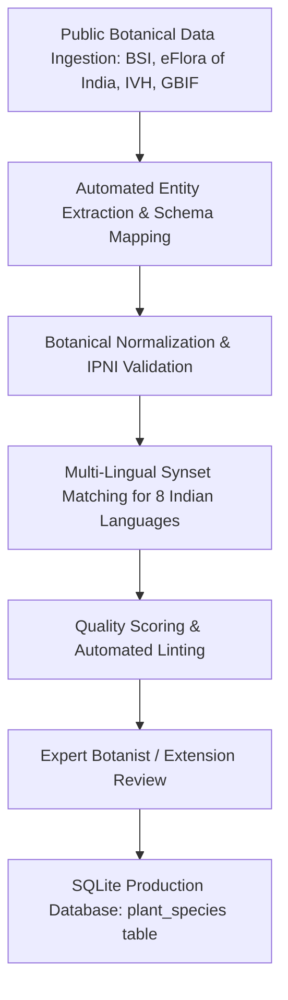

# AGRO AI — Indian Plant Catalog Architecture & Scaling Guide

## 1. Catalog Architecture & Scope

India's floral diversity encompasses over 45,000 plant species across 10 biogeographical zones. To power AGRO AI with reliable botanical, agronomic, and linguistic accuracy, we establish a **verified baseline catalog targeting up to 10,000 Indian plant species**.

The system is bootstrapped with a **fully verified seed catalog of 98 prominent Indian agricultural and botanical species**:
- **Crops (20 species)**: Staple cereals, pulses, millets, fiber crops, oilseeds, cash crops.
- **Vegetables (25 species)**: Solanaceous, cucurbits, brassicas, root tubers, leafy greens.
- **Fruits (21 species)**: Tropical, subtropical, and temperate fruits cultivated across Indian agro-climatic zones.
- **Medicinal & Spices (18 species)**: Key Ayurvedic herbs, rhizomes, aromatic spices, and adaptogens.
- **Trees & Ornamentals (14 species)**: Agroforestry timber, sacred and avenue trees, flowering perennials.

---

## 2. Botanical Standards & Taxonomy

To ensure scientific rigor across regional boundaries:
1. **APG IV Classification**: Orders and families adhere to the Angiosperm Phylogeny Group IV standard.
2. **Standard Binomial Nomenclature**: Validated against the International Plant Names Index (IPNI) and World Flora Online (WFO).
3. **Botanical Authorities**: Standard abbreviations for author citations (e.g., *L.* for Linnaeus, *Roxb.* for William Roxburgh).
4. **Synonyms**: Historical botanical names documented to prevent identification failures due to taxonomic revisions.

---

## 3. Strict Schema Structure

Every species record conforms to `backend/data/plant_catalog_schema.json`:

```json
{
  "$schema": "http://json-schema.org/draft-07/schema#",
  "title": "IndianPlantSpeciesRecord",
  "type": "object",
  "required": [
    "id",
    "scientificName",
    "commonName",
    "family",
    "genus",
    "species",
    "category",
    "statusInIndia",
    "leafCharacteristics",
    "growthHabit",
    "habitatAndClimate",
    "sunlightRequirements",
    "waterRequirements",
    "soilPreferences",
    "growingSeason",
    "propagationMethods",
    "uses",
    "safetyNotes",
    "isToxic",
    "commonPestsAndDiseases",
    "preventionGuidance",
    "sources",
    "verificationStatus",
    "lastCheckedDate"
  ]
}
```

### Detailed Field Breakdown
- **Identity**: Unique alphanumeric slug `id` (e.g., `crop_oryza_sativa`), `scientificName`, `commonName`.
- **Linguistic Diversity**:
  - `hindiName` (Devanagari script)
  - `teluguName` (Telugu script)
  - `tamilName` (Tamil script)
  - `otherRegionalNames` (Bengali, Marathi, Gujarati, Kannada, Malayalam, Odia, Punjabi).
- **Taxonomic Classification**: `family`, `genus`, `species`, `synonyms`, `category` (`crop`, `vegetable`, `fruit`, `medicinal_spice`, `tree_ornamental`).
- **Morphology**:
  - `leafCharacteristics`: shape (lanceolate, ovate, etc.), arrangement (alternate, opposite), margin (entire, serrate), venation (reticulate, parallel), color.
  - `stemCharacteristics`, `flowerCharacteristics`, `fruitCharacteristics`, `growthHabit`.
- **Agronomic Requirements**: `habitatAndClimate`, `sunlightRequirements`, `waterRequirements`, `soilPreferences`, `growingSeason`, `propagationMethods`.
- **Utilization & Safety**: `uses` (culinary, medicinal, timber, industrial), `safetyNotes`, `isToxic` (boolean flag).
- **Plant Protection**: `commonPestsAndDiseases` (name, symptoms, management), `preventionGuidance`.
- **Provenance & Verification**: `sources` (authoritative citation links), `verificationStatus` (`verified`, `provisional`), `lastCheckedDate`.

---

## 4. Current Seed Catalog Summary (98 Verified Species)

| Category | Count | Representative Taxa |
| :--- | :---: | :--- |
| **Crops** | 20 | Rice (*Oryza sativa*), Wheat (*Triticum aestivum*), Maize, Pearl Millet (Bajra), Sorghum (Jowar), Finger Millet (Ragi), Chickpea (Chana), Pigeon Pea (Arhar), Cotton, Sugarcane, Mustard, Soybean, Groundnut, Tea, Coffee, Rubber, Jute, Tobacco, Sunflower, Sesame. |
| **Vegetables** | 25 | Tomato (*Solanum lycopersicum*), Potato (*Solanum tuberosum*), Brinjal, Okra (Bhindi), Onion, Garlic, Bitter Gourd (Karela), Bottle Gourd (Lauki), Spinach (Palak), Cauliflower, Cabbage, Carrot, Radish, Ginger, Chilli, Fenugreek (Methi), Drumstick (Moringa), Cluster Beans (Guar), Ridge Gourd, Snake Gourd, Pumpkin, Ash Gourd, Beetroot, Sweet Potato, Colocasia (Arbi). |
| **Fruits** | 21 | Mango (*Mangifera indica*), Banana, Guava, Papaya, Pomegranate (Anar), Citrus (Nimbu/Orange), Apple, Grape, Sapota (Chiku), Custard Apple (Sitaphal), Jackfruit, Coconut, Aonla/Amla, Litchi, Pineapple, Watermelon, Fig (Anjeer), Jamun, Ber (Indian Jujube), Wood Apple (Bael), Cashew. |
| **Medicinal & Spices** | 18 | Tulsi (*Ocimum sanctum*), Turmeric (*Curcuma longa*), Ashwagandha, Neem (*Azadirachta indica*), Black Pepper, Cardamom, Clove, Cinnamon, Cumin (Jeera), Coriander (Dhania), Fennel (Saunf), Brahmi, Giloy/Guduchi, Aloe Vera, Shatavari, Kalmegh, Sarpagandha, Lemongrass. |
| **Trees & Ornamentals** | 14 | Banyan (*Ficus benghalensis*), Peepal (*Ficus religiosa*), Teak (*Tectona grandis*), Sal (*Shorea robusta*), Sandalwood (*Santalum album*), Gulmohar, Amaltas, Marigold (*Tagetes erecta*), Hibiscus, Jasmine, Rose, Bougainvillea, Flame of the Forest (Palash), Indian Rosewood (Sheesham). |
| **Total Verified** | **98** | **Zero schema validation errors across all 98 records.** |

---

## 5. Scaling Pipeline to 10,000 Species

To expand from the verified 98 baseline up to 10,000 Indian plant species, AGRO AI implements a 4-phase data expansion pipeline:



### Step 1: Authoritative Open Data Ingestion
- Harvest open metadata from **Botanical Survey of India (BSI)** and **eFlora of India** across state checklists.
- Query **Indian Virtual Herbarium (IVH)** records for state-wise geographical distribution.

### Step 2: Automated Entity Extraction & Schema Mapping
Run `backend/data/merge_plant_datasets.py` with custom ingest adapters to convert taxonomic checklists into the unified JSON schema.

### Step 3: Linguistic Normalization
Map regional vernacular names using the National Biodiversity Information Facility and Ayurvedic Pharmacopoeia of India (API) synsets across 8 primary Indian languages.

### Step 4: Database Ingestion
Run `backend/data/import_plant_catalog.py`:
- Populates the SQLite `plant_species` database table.
- Builds full-text search indexes on scientific binomials, English names, and Hindi, Telugu, and Tamil vernacular strings.
- Re-generates feature embeddings for the nearest-neighbor identification pipeline.
